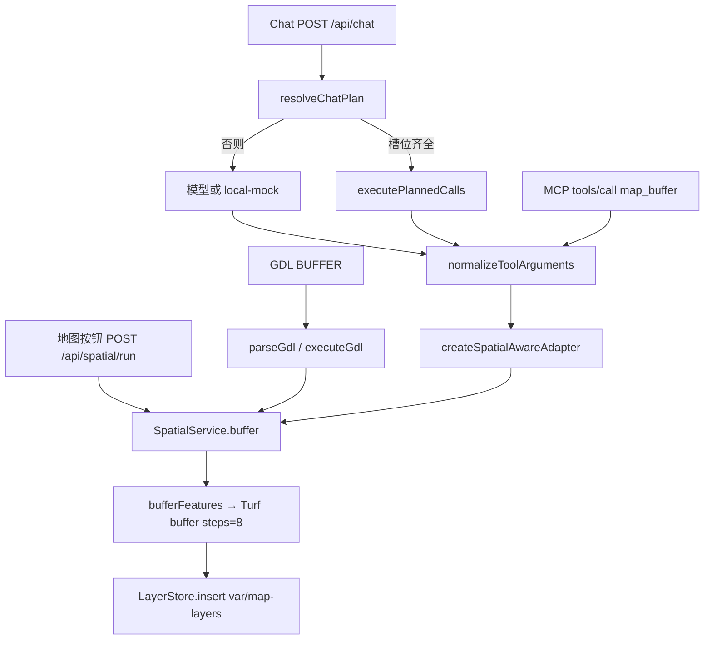

# Buffer 当前流程（V0.75-Clean Phase 2 Task 001）

证据只来自当前源码。本文不改任何业务逻辑。`docs/AI-HANDOFF.md` 把聊天链写成「本地解析成功就执行」这一支；`runLocalFirstTurn` 在 `resolveChatPlan` 返回 `model` 时还会调用已配置模型。下面以代码为准。

几何计算只有一处：`packages/surtgis/src/core/overlay.ts` 的 `bufferFeatures` 调用 Turf `buffer(feature, distance, { units: unit, steps: 8 })`。`packages/gis-kernel` 与 `packages/gis-tools` 里没有缓冲实现。

`steps` 不是任何入口的参数。圆滑分段固定为 `8`。

---

## 1. 入口一览

| 入口 | 是否当前桌面/MCP 运行路径 | 最终 GIS |
| --- | --- | --- |
| 聊天 `POST /api/chat`，本地槽位齐全 | 是 | `SpatialService.buffer` → `bufferFeatures` |
| 聊天同一接口，本地解析不完整，走模型或 `local-mock` | 是 | 同一 `SpatialService.buffer` |
| 地图「空间分析」按钮 `POST /api/spatial/run` | 是 | 同一 `SpatialService.buffer`，不经过工具适配器 |
| GDL `POST /api/gdl/load`，或聊天工具 `gdl.run` 里的 `BUFFER` | 是 | `executeGdl` → `GdlHost.buffer` → 同一 `SpatialService.buffer` |
| MCP stdio `tools/call`，工具名 `map_buffer` | 是（独立进程 `apps/cli/src/mcp-server.ts`，网页不依赖它） | `executeMcpTool` → 与聊天相同的适配器 → `SpatialService.buffer` |
| `planGisInstruction` 被 `createLocalChatMock` 调用 | 是，仅当本轮已经决定调用模型且提供方是 `local-mock` | 模型模拟返回 `map.buffer`，再进适配器 |
| `createLegacyLocalChatMock` / `spatialTool` | **NOT IN CURRENT RUNTIME PATH**。只被 `apps/cli/src/ai-eval.ts` 引用 | 若跑评测才会进适配器 |
| `takeCachedOrCompute` | **NOT IN CURRENT RUNTIME PATH**。全库无调用。缓冲缓存走 `SpatialService.derive` 里的 `cache.get` / `cache.put` | — |
| `packages/llm-dispatch/src/self-check.ts` 里的 `planGisInstruction` | **NOT IN CURRENT RUNTIME PATH**（自检） | 不写图层 |

---

## 2. 调用链

### 2.1 Chat（当前运行路径）

桌面服务：`apps/cli/src/desktop-api.ts` 的 `POST /api/chat`。

1. 入口：`POST /api/chat`。文件 `apps/cli/src/desktop-api.ts`。先 `conversations.append` 写入用户句，再 `spatialResultSink.run` 包住整轮。
2. `runLocalFirstTurn`（`packages/llm-dispatch/src/dispatch-policy.ts`）调用 `resolveChatPlan`（`packages/llm-dispatch/src/pending-plan.ts`）。
3. 本地意图：`normalizeInstruction` / `parseDistanceMeters`（`packages/llm-dispatch/src/local-intent.ts`）。认出「缓冲」且必填槽齐全时，`draftPendingPlan` 生成 `map.buffer` 调用。
4. 槽位齐全：`executePlannedCalls` → `normalizeToolArguments` → `validateToolArguments` → `adapter.execute`。
5. 适配器链（`apps/cli/src/gis-runtime.ts` 的 `openGisWorkspace`）：`createGdlAwareAdapter` → `createSpatialAwareAdapter` → `createGisToolAdapter`。`map.buffer` 在 `packages/spatial-ops/src/adapter.ts` 的 `createSpatialAwareAdapter` 被截下，不会进 `gis-tools`。
6. `SpatialService.buffer`（`packages/spatial-ops/src/service.ts`）做 `normalizeUnit`、`assertDistance`，再 `derive`。
7. `derive`：`requireCollection` 读 `LayerStore` → `validateCollection` → `readyForTurf` → `bufferFeatures`。
8. 图层写入：`MapLayerCatalog.insert`，即 `packages/surtgis/src/core/layer-store.ts` 的 `LayerStore.insert`。新图层 id 形如 `lyr-<时间>-<序号>`。

本地解析失败、意图含糊、或上一轮追问没有补上槽位时，`resolveChatPlan` 返回 `kind: "model"`。`runLocalFirstTurn` 调用 `runAssistantTurn` → `runLlmToolCallLoop`（`packages/llm-dispatch/src/loop.ts`）。模型工具名对外是 `run_buffer`（`toApiToolName`）。`normalizeToolArguments` 用 `canonicalToolName` 折回 `map.buffer`，然后仍走上面的适配器。

提供方为 `local-mock` 时，`fetchImpl` 是 `createLocalChatMock`。它用 `planGisInstruction`（`packages/llm-dispatch/src/gis-route.ts`）的 `distanceOf` 造工具参数，不是 `parseDistanceMeters`。云端模型则自己填 `run_buffer` 的参数，再被 `normalizeToolArguments` 整理。

危险操作确认包装 `guardDangerous` 只拦截 `map.delete`、`map.clearAll`、`map.dropDatabase`。缓冲不经过这道确认。

### 2.2 Map 按钮（当前运行路径）

1. 入口：`apps/desktop/ui/app.js` 里 `#analysis-run` 的点击。`operation` 来自 `#analysis-op`（缓冲为 `"buffer"`），`layerId` 来自 `#analysis-layer` 的 option value（图层 id，不是显示名）。
2. `POST /api/spatial/run`。文件 `apps/cli/src/map-http.ts` 的 `handleV05Request`。
3. `operation === "buffer"` 时直接 `deps.spatial.service.buffer(layerId, distance, unit, writeKnowledge)`。没有 `outputName` 参数，第四个之后的默认值是 `null`。
4. 不经过 `ToolAdapterPort`、`normalizeToolArguments`、`resolveLayerRef`、Pending Plan。
5. 之后与聊天相同：`derive` → `bufferFeatures` → `LayerStore.insert`。
6. 成功响应带回 `layer`。界面 `mountServerLayer` 把新图层画上地图。这条路径不写对话消息，也不写 `createdLayerIds`。

### 2.3 GDL（当前运行路径）

两条入口，几何都进同一个宿主：

- 地图/GDL 面板：`POST /api/gdl/load`。`apps/cli/src/gdl-http.ts` 的 `handleGdlRequest` 调用 `runGdl(..., { llm: false, writeKnowledge })`。
- 聊天工具：`createGdlAwareAdapter` 在 `call.tool === "gdl.run"` 时调用 `runGdl(..., { llm: true, writeKnowledge })`。`llm: true` 先走 `validateLlmGdl`（`packages/gdl/src/guard.ts`），禁止 `LAYER` 和几何字面量。

共同后续：

1. `parseGdl`（`packages/gdl/src/parser.ts`）把 `BUFFER` 收成 `{ kind: "buffer", input, distance, unit, output }`。
2. `executeGdl`（`packages/gdl/src/execute.ts`）按名字解析图层：脚本里刚定义的名字优先，否则 `host.resolveLayer`。
3. `gdl-http.ts` 的 `host.resolveLayer` 使用 `catalog.findByName`，精确同名，叠放最靠上的那层。
4. `host.buffer` 调用 `service.buffer(input.layerId, distance, unit, false, output)`。这里的 `writeKnowledge` 固定为 `false`。
5. 几何与写层仍是 `derive` → `bufferFeatures` → `LayerStore.insert`。
6. 若请求级 `writeKnowledge === true`，整段 GDL 摘要另写一条 RAG（`runGdl` 末尾的 `deps.addRag`），不是 `SpatialService.remember` 那条缓冲摘要。

`POST /api/gdl/parse` 只解析，不执行缓冲。`gdl.describe` 不缓冲。

### 2.4 MCP（当前运行路径，独立进程）

1. 入口：`apps/cli/src/mcp-server.ts` → `runMcpStdioServer`（`packages/mcp-server/src/stdio.ts`）。
2. `tools/call` 的名字经 `findMcpTool`：`map.buffer` 变成 `map_buffer`（点改下划线）。
3. `executeMcpTool`（`packages/mcp-server/src/execute.ts`）调用 `normalizeToolArguments`，再 `adapter.execute`。
4. 适配器就是 `openGisWorkspace` 返回的那条链，因此 `map.buffer` 仍进 `createSpatialAwareAdapter` → `SpatialService.buffer` → `bufferFeatures` → `LayerStore.insert`。
5. MCP 进程的 `modelName` 固定为 `"mcp"`。它不包 `spatialResultSink.run`，不写 `var/conversations`。
6. `--once` 与 `--list-tools` 不打开 GIS 运行时，不执行缓冲。

外部 MCP（设置里的 `mcpCommand`）经 `composeAdapters` 加在聊天适配器旁边。那是别人的工具，不是本仓库的 `bufferFeatures`。本仓库的 `map_buffer` 仍走上面第 4 步。

---

## 3. 参数

下表按「谁产生这个值」分开。类型是到达 `SpatialService.buffer` 之前、该层自己看到的类型。

### 3.1 源图层

| 入口 | 来源 | 类型 | 必填 | 默认 | 谁校验 | 谁消费 |
| --- | --- | --- | --- | --- | --- | --- |
| 聊天本地计划 | 用户文字里的已载入图层名；「当前图层」且没有写出名字时，用界面选中图层。后续步骤可用 `__prev__` 换成上一步结果名 | string | 计划里缺了会追问，不执行 | 无数值默认。缺名字则 `missing: ["layerId"]` | `resolveChatPlan` 要求名字在已知图层里；执行时 `resolveLayerRef` | `catalog.get(layerId)` 读几何 |
| 聊天模型 / MCP | 工具参数 `layerId`。别名 `layer` 等见 `ARG_ALIASES` | string | 工具表 `required: true` | 无 | `validateToolArguments` 查类型；`resolveLayerRef` 按 id、精确名、忽略大小写、互相包含匹配 | 同上 |
| 地图按钮 | `#analysis-layer` 的图层 id | string | HTTP 要求 `layerId` 非空字符串 | 无。未选图层时按钮直接提示，不发请求 | HTTP 只检查非空字符串。`requireCollection` 只按 id 查找，不按名称 | 同上 |
| GDL | `BUFFER` 第一个名字 | string | 语法必填 | 无 | 解析器要有名字；执行时 `findByName` 精确匹配 | `service.buffer` 收到的是 `layerId` |

### 3.2 距离

| 入口 | 来源 | 类型 | 必填 | 默认 | 谁校验 | 谁消费 |
| --- | --- | --- | --- | --- | --- | --- |
| 聊天本地计划 | `parseDistanceMeters` | number | 意图是缓冲时总会有数 | 文字里没有距离时 **200**，单位 meters | `> 0` 在解析器里；`assertDistance` 在服务里再查有限、`> 0` 和上限 | Turf `buffer` 的第二个参数 |
| 聊天模型 / MCP | 参数 `distance`。字符串 `"300米"` 会被 `splitDistance` 拆开 | number | 工具表必填 | 无。本地模拟 `distanceOf` 也不再在补图层名时填 200 | 工具层只要求 number。适配器再要求有限且 `> 0`。上限只在 `assertDistance` | 同上 |
| 地图按钮 | `Number(输入框)`。HTML 默认 value `"100"` | number | HTTP 要求 `typeof === "number"` | 界面初始 100。空输入变成 `0`（`Number("")`） | HTTP 不查 `> 0`。`assertDistance` 查 | 同上 |
| GDL | 语句里的数字，或粘在单位上的数字（`300米`） | number | 语法必填 | 无 | 解析器要求 `distance > 0`。上限只在 `assertDistance` | 同上 |

### 3.3 单位

| 入口 | 来源 | 类型 | 必填 | 默认 | 谁校验 | 谁消费 |
| --- | --- | --- | --- | --- | --- | --- |
| 聊天本地计划 | `parseDistanceMeters` **一律写成 `"meters"`**。千米/公里先乘 1000 | `"meters"` | 随距离一起出现 | 没有单位的裸数字也当成米 | 服务 `normalizeUnit` | Turf `units` |
| 聊天模型 / `distanceOf` / `normalize-args` | 保留单位：米→meters，千米/公里→kilometers，英里、英尺、度同理。**公里不乘 1000** | string | 工具表必填。距离字符串里带单位时可以补上 | 无 | `normalizeUnitText` 只做别名；认不出的字符串仍会通过工具校验。`normalizeUnit` 认不出则抛错 | Turf `units` |
| 地图按钮 | `#analysis-unit`：meters、kilometers、miles、feet、degrees | string | HTTP 要求非空字符串 | 下拉第一项 meters | `normalizeUnit` | Turf `units` |
| GDL | `normalizeGdlUnit`。允许 m/米、km/千米/公里、mi、ft、deg 及英文全称 | `GdlUnit` | 语法必填 | 无 | 解析器拒绝表外单位。`normalizeUnit` 会再认一次（这些值已经是 meters 等） | Turf `units` |

`assertDistance` 上限：`degrees` 为 180，`kilometers` 为 20000，其余（含 meters、miles、feet）为 10000000。超过则抛「缓冲距离太大，已拒绝。」

### 3.4 steps

当前代码没有这个参数。`bufferFeatures` 写死 `{ units: unit, steps: 8 }`。没有任何解析器、工具表或 HTTP 字段叫 `steps`。

### 3.5 结果图层名

| 入口 | 来源 | 必填 | 默认 | 谁处理 |
| --- | --- | --- | --- | --- |
| 聊天本地计划 | 不写 `outputName` | 否 | `derive` 用 `safeLayerName(输入图层名 + "_缓冲")` | `LayerStore.insert` |
| 工具表 / 模型 | 可选 `outputName` | 否 | 同上 | 适配器 `textArg(call, "outputName")` |
| `planGisInstruction`（仅 local-mock 后备） | 匹配「结果叫 / 命名为 / AS」 | 否 | 匹配不到则不传 | 同上 |
| 地图按钮 | 不发送 | 否 | `输入图层名_缓冲` | `safeLayerName` |
| GDL | `AS` 后面的名字 | 是 | 无。没有 `AS` 则语法错误，不执行 | 作为 `output` 传入 `service.buffer` |

`safeLayerName`：空白或像几何的文本变成「未命名图层」，否则截断到 80 字。请求名规范化后若是「未命名图层」，`derive` 改用 `输入图层名_缓冲`。

### 3.6 其他参数

| 参数 | 来源 | 必填 | 默认 | 谁校验 | 谁消费 |
| --- | --- | --- | --- | --- | --- |
| `writeKnowledge` | 本地缓冲计划 **固定 true**（`knowledge()`）。模型/`gis-route` 仅当文字含「写入知识库」或参数为 `true`。地图复选框默认不勾。GDL 调用 `service.buffer` 时固定 `false` | 否 | 见左 | 适配器只把 `=== true` 当真。HTTP 同样 | `remember`：成功且为 true 时写 RAG |
| `crsLabel` | 从输入图层元数据复制到新图层 | 否 | 输入图层上的标签 | 不参与缓冲校验 | 只写入新图层元数据。`bufferFeatures` 不读它 |
| 操作名 | 聊天 `map.buffer` / 对外 `run_buffer` / HTTP `"buffer"` / GDL `kind: "buffer"` | 是 | 无 | 各入口自己认名字 | 决定调用 `service.buffer` |

### 3.7 「300米」怎么走到 Turf

以用户文字「对道路做300米缓冲」且「道路」已载入、本地解析成功为例。

1. 文字仍是字符串。`parseDistanceMeters` 用 `/(\d+(?:\.\d+)?)\s*(米|m|meters?)/` 命中 `300米`。
2. `Number("300")` 得到 number `300`。单位写成 `"meters"`。这里没有换成度，也没有再换算。
3. `draftPendingPlan` 写入工具参数 `{ layerId: "道路", distance: 300, unit: "meters", writeKnowledge: true }`。
4. `normalizeToolArguments` 看到 distance 已是 number、unit 已是 `"meters"`，原样留下。`validateToolArguments` 只查类型和必填。
5. 适配器确认 distance 为有限数且 `> 0`，unit 非空，然后 `service.buffer(图层id, 300, "meters", true, null)`。
6. `normalizeUnit("meters")` 得到 `"meters"`。`assertDistance(300, "meters")` 通过（上限 10000000）。
7. `bufferFeatures` 对每个可用要素调用 `buffer(feature, 300, { units: "meters", steps: 8 })`。

「三百米」在本地解析里走 `parseCnInteger`：三百 → 300，单位仍是 meters，后面与上面第 3 步起相同。

同一句若没走本地计划、而走 `local-mock` 的 `distanceOf`：正则要阿拉伯数字，`300米` 仍是 distance `300`、unit `"meters"`。`三百米` 匹配不到距离，这次模拟不会排出 `map.buffer`。不再因为补图层名而填 200 米。

「300公里」两条解析不一致，见下一节。它不是「300米」。

---

## 4. 校验差异（不合并）

| 层次 | 聊天本地计划 | 聊天模型 / MCP | `POST /api/spatial/run` | GDL |
| --- | --- | --- | --- | --- |
| 文本解析 | `parseDistanceMeters`。公里乘 1000 后单位仍是 meters。没有距离则缺槽，不填 200。中文数字可以 | 云端模型自填。`local-mock` 用 `distanceOf`：`300公里` 是 300、kilometers，不乘 1000。不认「三百」。不填 200 | 无文本解析。界面已经是 number + 下拉单位 | `BUFFER` 语法。`300米` 可粘成一个词。不认中文数字。距离必须 `> 0`。单位必须在 `UNIT_ALIASES` |
| 参数整形 | `normalizeToolArguments`：别名、数字字符串、`300米` 这种距离字符串、单位中文 | 同左，模型路径和 MCP 都走 | 无。distance 不是 number 就 400 | 解析器产出 number + `GdlUnit` |
| 工具表 | `map.buffer`：layerId、distance、unit 必填；outputName、writeKnowledge 可选。不查距离上限，不查单位枚举 | 同左。MCP 把同一张表收成 `map_buffer` 的 JSON Schema | 不看工具表 | 不看工具表。`gdl.run` 只要求 `script` |
| 图层解析 | `resolveLayerRef`：id、精确名、忽略大小写、双向包含；多个候选则失败，不挑 | 同左 | 只 `catalog.get(layerId)`。名称当 id 会找不到 | `findByName` 精确同名，取叠放最上面一层 |
| GIS 校验 | `normalizeUnit` + `assertDistance` + `validateCollection` + `readyForTurf` + 要素数 2000 | 同左 | 同左。HTTP 不预先做这些 | 语法通过后同左。`service.buffer` 的 `writeKnowledge` 仍是 false |
| 几何字段 | 工具参数名若像几何，`validateToolArguments` 拒绝，不调用适配器 | 同左。`gdl.run` 另有 `validateLlmGdl` 拒绝几何字面量 | HTTP 正文可以带多余字段，缓冲分支不读它们，也不因此拒绝 | 用户 `llm: false` 允许 `LAYER` 几何。模型 `llm: true` 不允许 |
| 错误形态 | 适配器把 `SpatialOpError` 收成 `{ ok: false, message }`，聊天 HTTP 仍是 200 | MCP 再包成 `{ ok: false, code: "tool-error", message }` | `SpatialOpError` / `SurtGisCoreError` → HTTP 400。其他异常 → 500，文案换成「请求失败，服务仍在运行。」 | 语法错误或运行错误走 `failurePayload`。缓冲服务错误多半是 400，消息前加「GDL 第 N 行」 |

`readyForTurf` 丢掉空几何、结构无效和 `GeometryCollection`。自相交（`kind: "self-intersection"`）只记录，不在这里丢掉。`bufferFeatures` 里 `booleanValid` 为假的要素跳过，不让整次失败。

要素上限：缓冲 2000（`BUFFER_CAP`）。超过在调用 Turf 前抛「图层要素超过 2000，缓冲请先缩小图层。」

---

## 5. 副作用

成功且未命中缓存时，`derive` 的顺序是：算几何 → `insert` → `cache.put` → `publish` → `remember`（先审计，再按标志写 RAG）。

| 步骤 | 动作 | 文件 | 函数 | 落点 | 失败时 |
| --- | --- | --- | --- | --- | --- |
| 读入几何 | 从内存图层取 FeatureCollection | `layer-store.ts` | `collection` | 不新写盘 | 没有这层：抛「找不到输入图层」 |
| 几何检查 | 逐要素问题列表，最多 200 条 | `validate.ts` | `validateCollection` | 附在结果或错误上，不单独落盘 | 检查函数内部把异常收成问题，不向外抛 |
| 缓冲几何 | Turf 缓冲，无效要素跳过 | `overlay.ts` | `bufferFeatures` | 只在内存 | 单要素异常被 catch，记入 skipped。全部跳过则 `corrupt`，`derive` 抛错且不 `insert` |
| 新图层 | 写 GeoJSON、meta、顺序和样式 | `layer-store.ts` | `insert` | `var/map-layers/<id>.geojson`、`<id>.meta.json`、`layer-store.json` | 见第 6 节。写入中途失败时，前面已经写出的文件不会在 `derive` 里删掉 |
| 缓存 | 记下运算键到图层 id | `result-cache.ts` | `put` | `var/cache/<sha256>.json`，只有 key、layerId、layerName | `get` 失败当未命中。`put` 抛错时图层可能已经在盘上，且还没 `publish`、还没 RAG |
| 对话图层列表 | 把公开图层推进本次数组 | `service.ts` `publish`；`sink.ts` | `spatialResultSink.getStore` | 仅当调用方在 `AsyncLocalStorage.run` 里。聊天会；地图 HTTP、GDL HTTP、MCP 不会 | `getStore()` 为空则什么都不做，缓冲结果仍然在图层库 |
| RAG | 图层名、`run_buffer`、要素数、字段名 | `service.ts` | `remember` → `addRag` | `var/rag`（sqlite-vec） | catch 后 `ragEntryId = null`，缓冲仍算成功。GDL 另有一条摘要，失败时 `indexed = false`，HTTP 仍 200 |
| 审计 | 操作 buffer、距离、单位、成败、耗时 | `spatial-audit.ts` | `append` | `var/spatial-audit/<recordId>.json` | catch 后 `auditRecordId = null`。成功的缓冲不因此失败。失败路径仍抛原来的 GIS 错误 |
| 对话 | 用户句、助手回复、工具轨迹、`createdLayerIds`、Pending Plan | `conversations.ts` | `append` / `setPendingPlan` | `var/conversations/<id>.json` | 只覆盖聊天。地图按钮、GDL HTTP、MCP 不写这里 |
| 回退 | 按助手消息里的 id 删图层、RAG、审计 | `turn-rollback.ts` | `rollbackTurnEffects` | 删 `var/map-layers` 中对应生成文件，并删 RAG 行和审计文件 | 只处理对话里记下的 id。地图按钮生成的层不在这份清单里。回退自己的审计写入失败被忽略 |
| 命中缓存 | 不再 `insert`，返回已有图层 | `service.ts` `derive` | `cache.get` | 不新写 GeoJSON | 引用的图层已不在库里则当未命中，重新计算 |

本地聊天缓冲的 `writeKnowledge` 固定为 true，所以成功时会尝试 RAG。地图复选框默认关闭。GDL 的 `service.buffer` 不写这条 RAG；只有整段脚本的 `writeKnowledge` 为 true 时才写 GDL 摘要。

缓存键含操作名、输入图层 id、distance、unit、以及（若有）outputName 和几何哈希。相同缓冲再跑一次且结果层还在时，不会再插一层。GDL 每次都带 outputName，不同 `AS` 名字不会共用这一键。

---

## 6. 错误（只记当前行为）

### 缺少图层

- 聊天本地：名字不在已知图层里时，`resolveChatPlan` 改走模型，不在本地执行。模型或适配器里 `resolveLayerRef` 失败则返回 `{ ok: false, code: "unknown-layer" 或 "ambiguous-layer" }`，**不调用** `service.buffer`，因此没有缓冲审计。`executePlannedCalls` 停在这句，聊天整体仍是 HTTP 200。
- 地图 HTTP：`requireCollection` 抛「找不到输入图层。请先把图层载入地图。」`remember` 记一条失败审计（`writeKnowledge` 被关掉），然后 HTTP 400，正文是该句。
- GDL：`findByName` 失败抛 `GdlRuntimeError`「找不到图层 …」。发生在 `service.buffer` 之前，没有缓冲审计。`/api/gdl/load` 返回运行错误。`gdl.run` 收成 `{ ok: false, message }`。

### 缺少距离

- 聊天本地：不报错，距离变成 200、单位 meters，然后真的缓冲。
- 工具 / MCP：`validateToolArguments` 抛「缺少参数 distance。」适配器不跑。MCP 收成 `tool-error`。没有缓冲审计。
- 地图 HTTP：distance 不是 number 时，400「缓冲需要距离和单位。」不调用服务。空输入框是 `0`，不属于这一支，见非法距离。
- GDL：没有数字则语法错误「缺少缓冲距离。」不执行。

### 缺少单位

- 聊天本地：解析结果总带着 `"meters"`。
- 工具：未提供且距离字符串里也没有单位时，「缺少参数 unit。」不调用服务。
- 地图 HTTP：unit 不是非空字符串时，400「缓冲需要距离和单位。」
- GDL：单位不在别名表里则「缓冲单位只能是 m、km、mi、ft 或 deg。」不执行。

### 非法距离

- 工具适配器：`<= 0`、非有限数，在进服务前返回「缓冲距离必须是大于 0 的数。」**不写审计**。
- 地图 HTTP：`0`、负数、`NaN` 都是 number，会进 `assertDistance`，抛同一句，并写失败审计，HTTP 400。
- 超过上限：只有 `assertDistance`。聊天、地图、GDL、MCP 只要进了 `service.buffer` 都会抛「缓冲距离太大，已拒绝。」并写失败审计。适配器把它收成 `ok: false`。GDL 再包进行号。
- GDL 解析器只拒绝 `<= 0`，不拒绝超上限。

### 空几何

图层存在但没有可用要素（空集合，或全是空几何 / 结构无效 / GeometryCollection）：`readyForTurf` 之后抛「图层几何类型无法运算，已在调用前停止。」不调用 Turf，不 `insert`。失败审计会写。HTTP 400。适配器 `ok: false`。

### 无效几何

部分要素无效：跳过，成功图层只含缓冲成功的要素。消息里有「跳过 N 个无效要素。」`geometryIssues` 随结果返回（最多 200 条）。这是成功，审计 `success: true`。

全部要素在 `bufferFeatures` 里被跳过：`corrupt` 为真，抛「图层几何无效或已损坏，没有生成结果。」不 `insert`。失败审计会写。

自相交是否被 `booleanValid` 判失败，取决于 Turf 对那条几何的结果。代码只规定：自相交问题不会在 `readyForTurf` 被预先删除；`booleanValid` 为假才跳过。

### buffer 抛错

- 超过 2000 个要素：整次停止，文案见上，失败审计，不写新层。
- 单个要素 Turf 抛错：吞掉，跳过该要素，不让整次失败。
- 不是 `SpatialOpError` / `SurtGisCoreError` / `GisIoReadError` 的异常，会被 `asSpatialError` 换成「几何无效或已损坏，这次分析已停止。请检查图层后再试。」审计备注是这句，不是原始异常文本。

### 图层写入失败

`insert` 抛错后，`derive` 的 catch 尝试失败审计（`writeKnowledge: false`），再把错误抛出。不会补一次成功 RAG。文件系统异常会被换成上一节那句笼统文案。已经写出的 `.geojson` 若发生在后续 `writeMeta` / `writeState` 失败之前，代码没有回滚删除。

### RAG 失败

`remember` 内部 catch。缓冲结果仍是 `ok: true`，`ragEntryId` 为 null。GDL 脚本级 RAG 失败只把 `indexed` 设为 false，图层保留，接口仍成功。

### 审计失败

`remember` 内部 catch。成功的缓冲仍然成功，只是没有 `auditRecordId`。本来就要失败的缓冲仍然抛 GIS 错误。

---

## 7. 是否已有统一 GIS Executor

**NO。**

`SpatialService.buffer` 是各入口最终调用的缓冲方法，不是统一执行器。证据：

- 地图按钮在 `map-http.ts` 里直接调用 `service.buffer`，不经过 `ToolAdapterPort.execute`。
- GDL 在 `execute.ts` 的 `executeGdl` 里调用 `host.buffer`，宿主再调用 `service.buffer`。校验是 GDL 解析器，不是工具表。
- 聊天和 MCP 才共用 `createSpatialAwareAdapter` 的 `execute`。MCP 外面还有 `executeMcpTool`，聊天外面还有 `executePlannedCalls` 或 `runLlmToolCallLoop`。
- 三处对距离、单位、图层名、`writeKnowledge`、结果名的检查不一致（第 4 节）。
- 没有任何一种 Operation 对象被这些入口共同提交。`execute`、`gis-tools`、`dispatch` 是不同层的名字，不是同一个执行器。

---

## 8. 当前流程图

## 9. 目标流程图

**TARGET ONLY / NOT IMPLEMENTED。** 下面不是当前代码。

当前代码没有 Operation、没有单独的缓冲 Validator、没有缓冲 Policy、也没有单独的 Executor。地图和 GDL 直接进入 `SpatialService.buffer`。

---

## 10. UNKNOWN

- Turf 在图层坐标不是 WGS84 经纬度时，`units: "meters"` 的地面距离是否符合用户预期。代码不读 `crsLabel`。本次没有用样本几何做数值比对。
- 某条自相交几何会被 `booleanValid` 跳过还是被缓冲。代码两条路径都存在，结果取决于 Turf。
- 云端模型实际填进 `run_buffer` 的参数。代码只规定工具表和 `normalizeToolArguments`。
- 用户配置的外部 MCP 若自己提供缓冲工具，那次调用不会进入本仓库的 `bufferFeatures`。是否发生取决于外部进程，本仓库看不出来。
